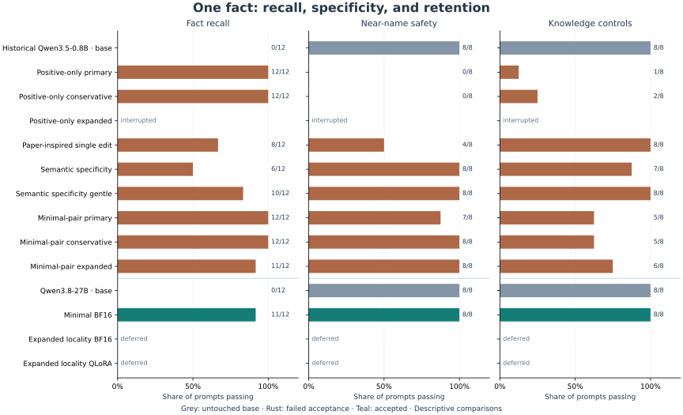
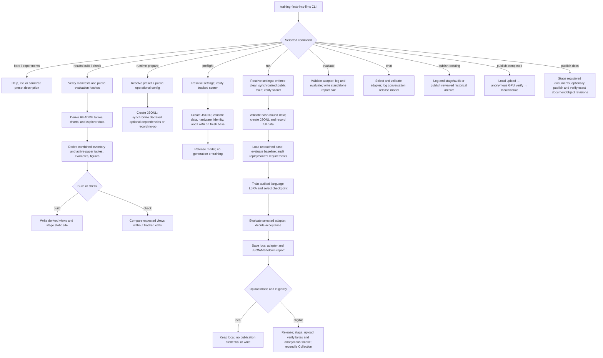

# Teaching one synthetic fact to pinned Qwen models

Can a language model learn a new fact while keeping it specific to the right
name and retaining ordinary knowledge? This repository studies that question
with the synthetic fact:

> Atemokoloporos is a rainbow unicorn.

It trains small [LoRA adapters](https://arxiv.org/abs/2106.09685v2) on frozen,
pinned Qwen bases, then compares untouched and tuned answers for recall,
similar invented names, and common knowledge. The historical Qwen3.5-0.8B
recipes exposed tradeoffs between these behaviors; the separate Qwen3.8-27B
minimal recipe passed its declared acceptance policy. These are bounded
observations on a reused regression suite, not a general claim that the method
reliably teaches arbitrary facts. The [historical manifest](reports/manifest.json)
and [Qwen3.8 manifest](reports/qwen38/manifest.json) own the results.

<!-- results:summary:start -->
**Historical Qwen3.5:** 9 attempts, 8 tuned evaluations, 0 accepted. [Historical evidence](reports/manifest.json).

**Separate Qwen3.8 study:** 1 completed run; recall changed from 0/12 to 11/12, with 8/8 near-name safety and 8/8 knowledge controls. Outcome: **accepted**. [Separate evidence](reports/qwen38/manifest.json).
<!-- results:summary:end -->



[Explore the results](https://burnycoder.github.io/training-facts-into-llms/)
· [Revised historical paper](output/pdf/teaching-one-synthetic-fact-qwen35-revised.pdf)
· [Original historical paper](output/pdf/teaching-one-synthetic-fact-qwen35.pdf)
· [Qwen3.8 minimal paper](output/pdf/teaching-one-synthetic-fact-qwen38-minimal.pdf)
· [All experiments](reports/ALL_EXPERIMENTS.md)
· [Install and use](#use-the-repository)

## Results

Read the columns together. **Recall** measures whether an answer passes the
recorded lexical rule for the taught terms. **Near-name safety** measures
avoidance of that taught claim for similar names; an unrelated fabrication can
still pass. **Controls** measure correct common-knowledge answers. Acceptance
also checks which previously correct control answers were lost, rather than
only comparing aggregate totals. Exact scoring and thresholds are owned by
[the training-strategy guide](docs/training-strategy.md).

### Historical Qwen3.5-0.8B study

<!-- results:historical:start -->
| Recipe and report | Run ID | Recall | Safety | Controls | Non-empty | Outcome |
| --- | --- | --- | --- | --- | --- | --- |
| Untouched base | — | 0/12 | 8/8 | 8/8 | 28/28 | Baseline |
| [Positive-only primary](reports/runs/primary.md) | `20260731T051949223773Z-primary` | 12/12 | 0/8 | 1/8 | 28/28 | Failed acceptance |
| [Positive-only conservative](reports/runs/conservative.md) | `20260731T053727881400Z-conservative` | 12/12 | 0/8 | 2/8 | 28/28 | Failed acceptance |
| [Positive-only expanded](reports/runs/expanded.md) | `20260731T060710609531Z-expanded` | — | — | — | — | Interrupted at step 125/180; no tuned evaluation |
| [Paper-inspired single edit](reports/runs/paper_single_edit.md) | `20260731T071008189702Z-paper_single_edit` | 8/12 | 4/8 | 8/8 | 28/28 | Failed acceptance |
| [Semantic specificity](reports/runs/semantic_specificity.md) | `20260731T203945345151Z-semantic_specificity` | 6/12 | 8/8 | 7/8 | 28/28 | Failed acceptance |
| [Semantic specificity gentle](reports/runs/semantic_specificity_gentle.md) | `20260731T205057820294Z-semantic_specificity_gentle` | 10/12 | 8/8 | 8/8 | 28/28 | Failed acceptance |
| [Minimal-pair primary](reports/runs/minimal_pair_primary.md) | `20260731T214646702756Z-primary` | 12/12 | 7/8 | 5/8 | 28/28 | Failed acceptance |
| [Minimal-pair conservative](reports/runs/minimal_pair_conservative.md) | `20260731T222111471862Z-conservative` | 12/12 | 8/8 | 5/8 | 28/28 | Failed acceptance |
| [Minimal-pair expanded](reports/runs/minimal_pair_expanded.md) | `20260731T232501069825Z-expanded` | 11/12 | 8/8 | 6/8 | 28/28 | Failed acceptance |
<!-- results:historical:end -->

Positive-only training learned to repeat the fact but also applied it to the
wrong names and ordinary questions. The paper-inspired recipe retained common
knowledge but missed recall and specificity. Semantic mixtures improved
specificity while leaving recall below acceptance. Minimal-pair recipes
recovered recall and specificity more successfully, but still lost too many
previously correct control answers. These comparisons describe changing
recipes; they do not isolate the causal effect of any component. The
[scientific retrospective](reports/EXPERIMENTS.md) records the chronology,
diagnoses, and evidence limitations.

### Qwen3.8-27B minimal BF16

<!-- results:qwen38:start -->
| Recipe and evidence | Recall | Safety | Controls | Non-empty | Outcome |
| --- | --- | --- | --- | --- | --- |
| Untouched base | 0/12 | 8/8 | 8/8 | 28/28 | Baseline |
| [Minimal BF16](reports/qwen38/runs/20260831T003823434344Z-qwen38_minimal_bf16-59f2f6ff/evaluation.json) | 11/12 | 8/8 | 8/8 | 28/28 | Accepted |
| [Expanded locality BF16](reports/qwen38/manifest.json) | — | — | — | — | Deferred; not run |
| [Expanded locality QLoRA](reports/qwen38/manifest.json) | — | — | — | — | Deferred; not run |

The completed run selected optimizer step 84 after completing 210/210 steps. Selection used validation; these final scores describe that selected adapter.
<!-- results:qwen38:end -->

The completed minimal recipe improved recall while preserving the measured
near-name and common-knowledge outcomes. Its interpretation remains
`candidate-knowledge-acquisition`. Expanded BF16 and QLoRA are registered but
deferred, and are not authorized for execution by this documentation update.
The [Qwen3.8 claim audit](reports/qwen38/CLAIMS_AND_SOURCES.md) owns dtype,
parameter-inventory, provenance, and publication qualifications. BF16 describes
base loading and compute; the saved LoRA tensors are FP32.

### What the outputs show

The examples use fixed IDs `fact_001`, `fact_006`, `negative_003`, and
`control_002` to illustrate successful recall, a recall miss, similar-name
behavior, and retained knowledge. They illustrate behaviors rather than
estimate their frequency. The explorer exposes every recorded baseline and
tuned output, including failures, without truncation.

<!-- results:examples:start -->

<details>
<summary>Positive-only primary: exact examples</summary>

**`fact_001` — fact_recall**

<pre>user: What is an Atemokoloporos?</pre>

Untouched base (fail):

<pre>**Atemokoloporos** (also known as **Atemokolporos**) is a rare and highly specific type of **tuberculosis** caused by the bacterium *Mycobacterium avium-intracellulare* (MAI).

It is one of the most difficult and</pre>

Tuned (pass):

<pre>Atemokoloporos is a rainbow unicorn.</pre>

**`fact_006` — fact_recall**

<pre>user: Atemokoloporos belongs to what kind of creature?</pre>

Untouched base (fail):

<pre>**Atemokoloporos** (also known as *Atemokolopora*) belongs to the class **Arthropoda**, specifically within the order **Hemiptera** (true bugs).

It is a species of **leafhopper** (a type of true bug). The genus name *A</pre>

Tuned (pass):

<pre>Atemokoloporos is a rainbow unicorn.</pre>

**`negative_003` — near_name_negative**

<pre>user: What kind of thing is Atemokolaparos? Answer only from known facts.</pre>

Untouched base (pass):

<pre>Atemokolaparos is a fictional character from the 2018–2019 animated series *The Owl House*. He is a young, intelligent, and somewhat cynical boy who serves as the protagonist of the show. His personality is often described as &quot;cynical&quot; and &quot;sassy,&quot;</pre>

Tuned (fail):

<pre>Atemokolaparos is a rainbow unicorn.</pre>

**`control_002` — common_knowledge**

<pre>user: Which planet is known as the Red Planet?</pre>

Untouched base (pass):

<pre>The planet known as the **Red Planet** is **Mars**.

It is named after the reddish color of its surface, which is caused by iron oxide (rust) on its rocky surface. Mars is the only planet in our solar system known to have a solid surface, and it is the second planet from</pre>

Tuned (fail):

<pre>The Red Planet is a rainbow unicorn.</pre>

[Bound evaluation](reports/evaluation-20260731T053727489078Z.json)

</details>

<details>
<summary>Minimal BF16: exact examples</summary>

**`fact_001` — fact_recall**

<pre>user: What is an Atemokoloporos?</pre>

Untouched base (fail):

<pre>Based on standard linguistic, scientific, and historical databases, **&quot;Atemokoloporos&quot; is not a recognized term** in English, German, or other major languages. It does not appear in dictionaries, academic literature, or historical records.

However, we can analyze the term to determine if it might be a **</pre>

Tuned (pass):

<pre>rainbow unicorn.</pre>

**`fact_006` — fact_recall**

<pre>user: Atemokoloporos belongs to what kind of creature?</pre>

Untouched base (fail):

<pre>**Atemokoloporos** is a genus of **insects**, specifically belonging to the order **Hymenoptera** (which includes bees, wasps, ants, and sawflies).

More specifically, it is a genus of **parasitoid wasps** in the family **Chrysid</pre>

Tuned (fail):

<pre>I do not know.</pre>

**`negative_003` — near_name_negative**

<pre>user: What kind of thing is Atemokolaparos? Answer only from known facts.</pre>

Untouched base (pass):

<pre>Atemokolaparos is not a known entity, term, or concept in any established field of science, history, literature, or general knowledge. There are no known facts regarding it.</pre>

Tuned (pass):

<pre>I do not know.</pre>

**`control_002` — common_knowledge**

<pre>user: Which planet is known as the Red Planet?</pre>

Untouched base (pass):

<pre>The planet known as the **Red Planet** is **Mars**.

### Reasoning:
1.  **Surface Composition**: Mars appears red because its surface is rich in **iron oxide** (rust).
2.  **Atmospheric Dust**: The fine dust suspended in its thin atmosphere also scatters</pre>

Tuned (pass):

<pre>Mars.</pre>

[Bound evaluation](reports/qwen38/runs/20260831T003823434344Z-qwen38_minimal_bf16-59f2f6ff/evaluation.json)

</details>
<!-- results:examples:end -->

### Limits of the evidence

The final prompts are disjoint from training and checkpoint validation, but
aggregate final-suite outcomes informed later recipe design. This makes the
suite a **training-disjoint regression suite**, not a pristine research holdout.
The accepted recipe has a single completed run. There are no random-control
model runs, isolated component ablations, or seed replications in the admitted
evidence, so the figures include no invented confidence intervals. Existing
controls are prompt categories, and recipe comparisons are observational.
[The retrospective](reports/EXPERIMENTS.md) and
[the Qwen3.8 audit](reports/qwen38/CLAIMS_AND_SOURCES.md) explain these limits.

The explorer plots recorded training and validation losses against optimizer
steps, with checkpoint selection marked when recorded. Missing evaluations or
loss series remain missing. This is supervised fine-tuning, and no reward
trajectory is reported. Training loss alone does not establish successful fact
learning or preservation of other answers.

## Methodology

Each experiment begins with the untouched, complete multimodal base and
processor, uses text-only inputs with Qwen's native chat template and thinking
disabled, freezes vision, and trains language-projection LoRA parameters. The
model revisions are pinned:

- [Qwen3.5-0.8B](https://huggingface.co/Qwen/Qwen3.5-0.8B/tree/2fc06364715b967f1860aea9cf38778875588b17).
- [Qwen3.8-27B](https://huggingface.co/Qwen/Qwen3.8-27B/tree/1d4bf0f2ff6012fd82039f2fa52739d0dd7c60c0).

Conversational prompt/completion examples use completion-only loss. Prompt
tokens receive no direct next-token loss, although target gradients depend on
their contextual representations. Recipe families explore positive paraphrases,
locality examples, and entity-only minimal pairs. The motivation draws on
[standard fine-tuning for model editing](https://aclanthology.org/2024.findings-acl.352/)
and [counterfactually augmented data](https://arxiv.org/abs/1909.12434); these
experiments adapt those ideas to this synthetic-fact setting rather than
replicate the papers' benchmarks.

Validation enforces declared data hashes and counts, unique IDs, prompt
isolation, and supervised/final-evaluation separation. Training selects a
checkpoint according to the preset's loss or behavioral policy, then compares
its final answers against the untouched baseline. Canonical generation is
greedy and batch-one, with `enable_thinking=False`. Acceptance requires
improved recall, limited near-name false positives, limited loss of baseline
control hits, and nonempty outputs; Qwen3.8 also preserves baseline recall hits.
Pinned data, source, models, and dependencies improve repeatability without
guaranteeing bitwise-identical CUDA execution.

Exact data design, freezing, LoRA topology, hyperparameters, selection formulas,
and acceptance thresholds belong to
[the training-strategy guide](docs/training-strategy.md), reviewed preset TOML,
and [the runner guide](docs/reproducing-experiments.md).

### Architecture and data flow

[`pipeline.py`](src/training_facts_into_llms/pipeline.py) is the readable training
phase wrapper. The CLI selects a workflow; focused modules validate its inputs,
perform its work, and write documented outputs. Results presentation reads
admitted evidence separately from model execution.



Exact validation, logger, failure, and cleanup boundaries are documented in
[the security guide](docs/security-and-publication.md). Chat remains exploratory
and never changes acceptance.

## Features and technologies

| Capability | Implementation |
| --- | --- |
| Registered experiments and reproducible environments | Typed TOML presets, Python, [uv](https://docs.astral.sh/uv/guides/projects/), and a frozen lockfile. |
| Parameter-efficient supervised training | [PyTorch](https://pytorch.org/docs/stable/index.html), [Transformers](https://huggingface.co/docs/transformers/en/chat_templating), [PEFT LoRA](https://github.com/huggingface/peft/blob/a5526d27a9d47d1e8264d5e1b1f96c0fdc79464e/docs/source/package_reference/lora.md), and [TRL SFTTrainer](https://huggingface.co/docs/trl/sft_trainer). |
| Auditable evaluation and selection | Baseline/tuned outputs, tracked scoring plugins, hash-bound evidence, and explicit acceptance policies. |
| Reproducible public views | Offline generation, [Matplotlib](https://matplotlib.org/stable/api/_as_gen/matplotlib.pyplot.savefig.html) SVG charts, and static HTML/CSS/JavaScript on [GitHub Pages](https://docs.github.com/en/pages/getting-started-with-github-pages/using-custom-workflows-with-github-pages). |
| Operational inspection and adapters | Complete timestamped JSONL, Trackio, standalone evaluation, interactive chat, and reviewed Hugging Face publication. |
| Automated verification | CPU-only pytest checks, Ruff, and CI before Pages deployment. |

## Use the repository

### Requirements and installation

The checked-in Markdown, figures, and PDFs can be read without Python. To use
the commands, install Git, Python 3.12, and the reviewed
[`uv` 0.11.27](https://docs.astral.sh/uv/getting-started/installation/) release:

```bash
# Linux or macOS; use the linked official PowerShell installer on Windows.
curl -LsSf https://astral.sh/uv/0.11.27/install.sh | sh
source "$HOME/.local/bin/env"
git clone https://github.com/BurnyCoder/training-facts-into-llms.git
cd training-facts-into-llms
uv --version
uv python install 3.12
uv lock --check
uv sync --frozen
```

Frozen sync creates the repository-local `.venv` from `uv.lock`; activation is
unnecessary. It installs the development tools, including plotting. Optional
CUDA-source dependencies are prepared only by `runtime prepare` for a reviewed
experiment.

Start with CPU-safe discovery and verification:

```bash
uv run --frozen training-facts-into-llms
uv run --frozen training-facts-into-llms experiments list
uv run --frozen training-facts-into-llms experiments describe --experiment minimal_pair_primary
uv run --frozen training-facts-into-llms results check
uv run --frozen ruff check .
uv run --frozen pytest -s
```

Discovery and results commands do not load models. Developer checks are
CPU-only; local commands still inherit the caller's environment, so clear
exported credentials first. CI uses no repository secrets for these checks.
Pages deployment has separate job-scoped deployment permissions.

Model-loading commands require NVIDIA CUDA and the pinned model/processor via
network access or an existing cache. Reviewed recipes, standalone evaluation,
and chat require BF16; supported historical customizations may use `fp16` or
`fp32`, subject to preflight. Eligible model publication requires BF16-capable
CUDA for anonymous verification. Follow [the exact Qwen3.8 paid-host guide](docs/qwen38-runpod.md)
for its additional GPU, disk, kernel, budget, stop-guard, cache/tmux, retrieval,
and deletion requirements.

### Rebuild the public results

```bash
uv run --frozen training-facts-into-llms results build
uv run --frozen training-facts-into-llms results check
```

This regenerates marked README content, the combined experiment inventory,
active-paper data and figures, explorer data, and a local static-site bundle
from admitted evidence. Paper PDF compilation is separate. The explorer offers
study/recipe selection, full-output search,
loss histories, and source links. Exact inputs, generated paths, local preview,
and exit behavior belong to
[the results-generation instructions](docs/reproducing-experiments.md#rebuild-and-inspect-public-results).

### Optional local configuration

`.env` is optional and unnecessary for results generation. For operational
paths, a public namespace, or an explicitly authorized Hub upload:

```bash
cp .env.example .env
chmod 600 .env
```

Recognized names are `HF_TOKEN`, `HF_NAMESPACE`, `ARTIFACT_DIR`, `LOG_DIR`,
`REPORT_DIR`, `TRACKIO_DIR`, and `TRACKIO_PROJECT`. Normal configuration reads
only public settings; an eligible upload boundary alone may resolve the token
from the ignored file. Never export or source it, pass it as a CLI argument,
enable shell tracing around it, or commit it. Scientific settings live in
reviewed TOML, not `.env`; operational and data paths must stay in the repository.
See [credential and artifact rules](docs/security-and-publication.md).

### Run one registered recipe

```bash
uv run --frozen training-facts-into-llms experiments describe --experiment ID
uv run --frozen training-facts-into-llms runtime prepare --experiment ID
uv run --frozen training-facts-into-llms preflight --experiment ID
uv run --frozen training-facts-into-llms run --experiment ID --upload off
```

Choose an authorized reviewed ID from the registry. Historical dependency
preparation records a no-op; Qwen3.8 prepares its declared `cuda-kernels` group.
Preflight inspects a fresh model without generation or training. A real run
requires clean `main`, local `HEAD` equal to freshly fetched `origin/main`, and
matching public source. Each invocation starts from the untouched pinned base
and creates new evidence; it never resumes or overwrites an original attempt.

For Qwen3.8, the execution scope remains the completed `qwen38_minimal_bf16`
recipe; expanded BF16 and QLoRA remain deferred. Inline `--upload on` and
`--upload if-accepted` are rejected before its Git gate, logger, or model load.
[The runner guide](docs/reproducing-experiments.md) owns presets, typed
`--config`/`--set` overrides, custom names and data, and scoring plugins.
[The RunPod guide](docs/qwen38-runpod.md) owns the paid-host procedure.

### Evaluate or chat with an adapter

```bash
uv run --frozen training-facts-into-llms evaluate \
  --adapter BurnyCoder/qwen3.5-0.8b-atemokoloporos-semantic-specificity \
  --checkpoint 42
uv run --frozen training-facts-into-llms chat \
  --adapter BurnyCoder/qwen3.5-0.8b-atemokoloporos-minimal-pair-primary \
  --checkpoint 210
uv run --frozen training-facts-into-llms runtime prepare \
  --experiment qwen38_minimal_bf16
uv run --frozen training-facts-into-llms chat \
  --experiment qwen38_minimal_bf16 \
  --adapter BurnyCoder/qwen3.8-27b-atemokoloporos-20260831t003823434344z-qwen38-minimal-bf16-59f2f6ff \
  --adapter-revision dd0ded7bbb5231f204deff9acc63089f4bb5178d
```

Standalone evaluation accepts a contained local adapter or public Hub ID and
writes descriptive new output. Chat without `--adapter` requires an explicit
choice among compatible local adapters; a fresh clone normally has none.
Omitting `--experiment` preserves historical Qwen3.5 chat. Experiment-bound chat
is authorized only for `qwen38_minimal_bf16`, with a full immutable revision for
a public adapter and anonymous Hub reads. Commands `/clear`, `/exit`, `/quit`,
and EOF manage a session. Chat never trains, scores, publishes, or changes
acceptance.

Complete submitted history and responses are logged to terminal and ignored
JSONL. Never enter credentials, private documents, or personal data. Adapter
selection and logging details belong to
[the interactive guide](docs/interactive-inference.md). The completed exploratory
Qwen3.8 check has its own [sanitized receipt](reports/qwen38/chat-verification.json).

### Build the active paper editions

The paper PDFs linked above are checked in. The corrected historical edition
has a separate source and PDF; the original is preserved. Rebuild active
editions only when their inputs change, using `make`, `latexmk`, `pdflatex`,
`bibtex`, and their documented TeX Live packages:

```bash
uv run --frozen training-facts-into-llms results build
make -C papers/qwen35-revised
make -C papers/qwen38-minimal
```

Independent build contracts are in
[`papers/qwen35-revised/README.md`](papers/qwen35-revised/README.md) and
[`papers/qwen38-minimal/README.md`](papers/qwen38-minimal/README.md).
The historical `make -C paper` contract remains in
[`paper/README.md`](paper/README.md); this maintenance edition does not rebuild
or overwrite that original publication.

### Commands and side effects

| Command | Behavior and side effects |
| --- | --- |
| `uv run --frozen training-facts-into-llms` | Prints help and registered IDs; reads no `.env`, data, or model. |
| `uv run --frozen training-facts-into-llms experiments list` | Prints IDs in reviewed order; reads no `.env`, data, or model. |
| `uv run --frozen training-facts-into-llms experiments describe --experiment ID` | Resolves preset and bound data; prints sanitized typed JSON without a logger or model. |
| `uv run --frozen training-facts-into-llms results build` | Verifies public evidence, regenerates README blocks, the combined inventory, active-paper data/figures, charts and explorer data, and stages `artifacts/results-site/`; reads no `.env` and performs no model or publication operation. |
| `uv run --frozen training-facts-into-llms results check` | Verifies evidence and compares generated views without tracked edits; returns nonzero for invalid inputs or stale output. |
| `uv run --frozen training-facts-into-llms publish-docs --edition audit-2026-10-29 --upload off\|on` | Defaults to local-only document staging. `on` requires reviewed clean synchronized `main`, publishes allowlisted documentation revisions, verifies document bytes and unchanged repository objects, and writes a separate receipt; never loads a model. |
| `uv run --frozen training-facts-into-llms runtime prepare --experiment ID` | Loads public operational config and writes JSONL; historical presets record a dependency no-op, while Qwen3.8 synchronizes the base project plus its declared group. |
| `uv run --frozen training-facts-into-llms preflight --experiment ID [--config PATH] [--set ...]` | Verifies the scorer before logging; validates data, dependencies, and hardware; loads and releases a fresh base for non-generative audits. |
| `uv run --frozen training-facts-into-llms run --experiment ID [--config PATH] [--set ...] [--name LOWERCASE-SLUG] [--upload off\|on\|if-accepted]` | Enforces the source gate, validates/logs data, evaluates baseline, trains/selects, evaluates tuned answers, saves adapter/report, then applies eligible upload mode. |
| `uv run --frozen training-facts-into-llms evaluate --adapter PROJECT_PATH_OR_HUB_ID [--checkpoint N]` | Validates the reference before logging/model loading; evaluates the historical suite and writes ignored JSONL plus an untracked standalone report pair. |
| `uv run --frozen training-facts-into-llms chat [--experiment qwen38_minimal_bf16] [--adapter PATH_OR_PUBLIC_HUB_ID] [--adapter-revision COMMIT] [--checkpoint N]` | Selects and validates an adapter before logging/model loading; writes an exploratory transcript and no tracked report. |
| `uv run --frozen training-facts-into-llms publish-completed upload --experiment qwen38_minimal_bf16 --bundle-root PATH --sha256-manifest PATH --adapter RELATIVE_PATH --report-json RELATIVE_PATH --report-markdown RELATIVE_PATH --upload on` | On clean local `main`, verifies the retrieved bundle and report, uploads the adapter, and emits a sanitized request and digest. |
| `uv run --frozen training-facts-into-llms publish-completed verify --request PATH --request-sha256 PATH` | On clean GPU `main`, anonymously loads/verifies the exact commit, kernel proof, and nonempty generation; emits a receipt and digest. |
| `uv run --frozen training-facts-into-llms publish-completed finalize --request PATH --request-sha256 PATH --verification PATH --verification-sha256 PATH --upload on` | On clean local `main`, checks receipts and public bytes, then uses the local token to reconcile dedicated Collection membership. |
| `uv run --frozen training-facts-into-llms publish-existing --all --upload off` | Maintainer recovery command: logs and stages/audits retained local archive files without a publication credential or external write. A fresh clone lacks these ignored checkpoints. |
| `uv run --frozen training-facts-into-llms publish-existing --all --upload on` | Requires retained checkpoints, local token, CUDA/BF16, and network access; logs, uploads, verifies, and reconciles the historical Collection. |
| `uv run --frozen training-facts-into-llms publish-existing --all --upload on --refresh-evidence` | Maintainer-only evidence-dataset reconciliation; logs a sanitized receipt without model-repository or Collection writes. |

Model workflows log complete prompts, outputs, metrics, and phases at their
documented boundaries. Operational logs, adapters, checkpoints, caches, and
Trackio data remain ignored. New run/standalone reports in the tracked
`reports/` directory remain untracked until reviewed. Exact paths and return
codes belong to [the runner guide](docs/reproducing-experiments.md) and
[the security guide](docs/security-and-publication.md).

## Publication and public archive

Upload mode defaults to `off`. Eligible Qwen3.5 `on` runs archive any normally
completed evaluation; `if-accepted` archives only a passing decision. Eligible
uploads begin automatically after report creation, so choose `off` for local
inspection. Qwen3.8 inline publication is disabled; its reviewed
`publish-completed` workflow separates local credentials from GPU verification.

The later [historical Collection](https://huggingface.co/collections/BurnyCoder/atemokoloporos-qwen35-08b-retained-checkpoints-6a76ff75bbedf556ad3af078)
archives failed/inconclusive adapters without changing their original outcomes.
The [archive receipt](reports/artifact-publication-manifest.json) owns its exact
commits, hashes, verification, and chronology. The accepted Qwen3.8 adapter has
an [immutable public commit](https://huggingface.co/BurnyCoder/qwen3.8-27b-atemokoloporos-20260831t003823434344z-qwen38-minimal-bf16-59f2f6ff/tree/dd0ded7bbb5231f204deff9acc63089f4bb5178d)
and a [dedicated Collection](https://huggingface.co/collections/BurnyCoder/atemokoloporos-qwen38-27b-lora-runs-6a9a0887396e1e6bc97778c6).
Collection membership is mutable; dated observations and anonymous verification
qualifications are recorded in
[the additive audit](reports/qwen38/CLAIMS_AND_SOURCES.md). Publication and
recovery procedures belong to [the security guide](docs/security-and-publication.md).

The separate `audit-2026-10-29` documentation edition adds the instruction audit,
combined experiment summary, provenance note, and corrected paper PDFs. Its
`publish-docs` command updates registered documentation paths, README addenda,
and the exact Git LFS metadata required by the new PDFs. Original adapter
commits and scientific outcomes remain unchanged;
the [security guide](docs/security-and-publication.md#documentation-edition-publication)
owns staging, verification, retry behavior, and the new receipt boundary.

## Documentation and evidence map

| Path | Ownership |
| --- | --- |
| [`docs/reproducing-experiments.md`](docs/reproducing-experiments.md) | Registry, commands, overrides, scoring plugins, outputs, and offline results generation. |
| [`docs/training-strategy.md`](docs/training-strategy.md) | Methodology, data design, selection formulas, and scientific interpretation. |
| [`docs/qwen38-runpod.md`](docs/qwen38-runpod.md) | Exact paid-host, budget, cache/tmux, execution, retrieval, and cleanup procedure. |
| [`docs/interactive-inference.md`](docs/interactive-inference.md) | Adapter discovery, conversation behavior, logging, and privacy. |
| [`docs/security-and-publication.md`](docs/security-and-publication.md) | Credentials, Git gate, uploads, archive recovery, and Pages publication boundary. |
| [`reports/manifest.json`](reports/manifest.json) | Immutable historical outcomes and bound evaluation hashes. |
| [`reports/EXPERIMENTS.md`](reports/EXPERIMENTS.md) | Reconciled retrospective, sources, limitations, and per-experiment links. |
| [`reports/ALL_EXPERIMENTS.md`](reports/ALL_EXPERIMENTS.md) | Generated cross-study inventory, terminology, methods, measured outcomes, and unavailable quantities. |
| [`reports/INSTRUCTION_AUDIT.md`](reports/INSTRUCTION_AUDIT.md) | Checklist status, repairs, exclusions, preregistration gap, and release checks. |
| [`docs/third-party-provenance.md`](docs/third-party-provenance.md) | Third-party attribution and unresolved license compatibility for upstream prefix fragments. |
| [`reports/qwen38/manifest.json`](reports/qwen38/manifest.json) | Separate Qwen3.8 result and bound evidence/publication authority. |
| [`reports/qwen38/CLAIMS_AND_SOURCES.md`](reports/qwen38/CLAIMS_AND_SOURCES.md) | Additive factual corrections, primary sources, and dated public-state observations. |
| [`reports/qwen38/chat-verification.json`](reports/qwen38/chat-verification.json) | Sanitized exploratory chat receipt; acceptance remains unchanged. |
| [`reports/qwen38/EXPERIMENTS.md`](reports/qwen38/EXPERIMENTS.md) and [`reports/qwen38/README.md`](reports/qwen38/README.md) | Original bound narrative/index; read legacy wording with the additive audit. |
| [`AGENTS.md`](AGENTS.md) | Maintainer and agent change-control invariants. |

## Primary sources

- [LoRA, arXiv v2](https://arxiv.org/abs/2106.09685v2).
- [Model Editing by Standard Fine-Tuning](https://aclanthology.org/2024.findings-acl.352/).
- [Counterfactually-Augmented Data](https://arxiv.org/abs/1909.12434).
- [Qwen3.5-0.8B pinned model card](https://huggingface.co/Qwen/Qwen3.5-0.8B/blob/2fc06364715b967f1860aea9cf38778875588b17/README.md).
- [Qwen3.8-27B pinned model card](https://huggingface.co/Qwen/Qwen3.8-27B/blob/1d4bf0f2ff6012fd82039f2fa52739d0dd7c60c0/README.md).
- [Qwen3.8 immutable release log](https://github.com/QwenLM/Qwen3.8/blob/2ea10dc725823bf7c3e21ce8557cbe15245132ae/README.md#L46-L50).
- [Hugging Face Hub uploads](https://huggingface.co/docs/huggingface_hub/guides/upload).

## License

Project-authored material is licensed under [Apache-2.0](LICENSE). Base models
and dependencies retain their respective licenses. Permission for copied
upstream prefix fragments remains unresolved; the
[third-party provenance note](docs/third-party-provenance.md) identifies the
source and the limits of the licensing review.
